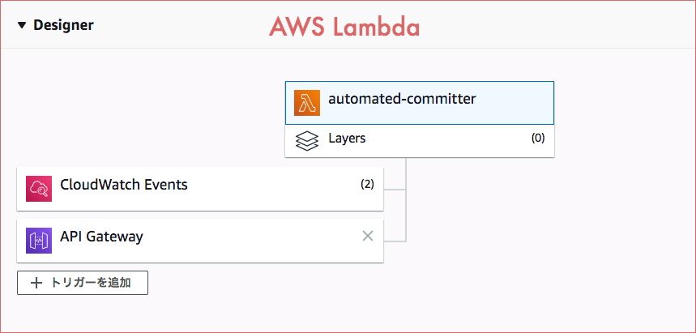

webpage-caller-for-aws
===

環境変数で指定した Web ページを AWS Lambda から呼び出すだけ。

- Docker: 対応!
- Python: 3.14!
- Linter: ruff, hadolint!
- Test: pytest!
- requests: 2.34!

## パッと実行してみたい

コマンドは bash 前提。 Windows では WSL などの bash 環境で実行する。

```bash
docker compose up --build -d
curl -s -X POST http://localhost:9000/2015-03-31/functions/function/invocations -d '{}'
# => {"statusCode": 200, "body": "{\"result\": 200}"}
docker compose logs app
# => app-1  | TARGET_URL responded with 200 (ほかに RIE のログも出る)
docker compose down
```

公式イメージに付属する Runtime Interface Emulator を使い、ローカルでも Lambda と同じ形式で呼び出せる。

呼び出し先は環境変数 `TARGET_URL` で指定する。
Docker Compose で省略すると `https://example.com/` を使う。
Lambda では `TARGET_URL` の指定が必要。

```bash
TARGET_URL=https://example.org/ docker compose up --build -d
```

接続や読み取りのタイムアウトは 10 秒。超えると `requests.exceptions.Timeout` 系の例外になる。
リダイレクト先も追いかけ、`result` には最後のレスポンスのステータスコードを入れる。

呼び出し先のステータスコードはログにも出す。
EventBridge (旧 CloudWatch Events) から定期実行するときも、CloudWatch Logs で結果を確認できる。
URL はトークンを含むことがあるので、通常の結果ログには出さない。
接続エラーやタイムアウト時の例外メッセージには URL が含まれることがある。

## テストと lint

```bash
docker compose run --rm dev pytest
docker compose run --rm dev ruff check .
docker compose run --rm dev ruff format --check .
docker run --rm -i hadolint/hadolint:v2.15.1 < Dockerfile
```

ローカルに Python 3.14 と pipenv があれば、`pipenv install --dev` → `pipenv run pytest` でも OK。

単体テストは requests のモックとローカルのソケット・HTTP サーバーを使う。外には通信しない。
GitHub Actions では lint・テストに加え、Docker と配布用 zip の両方を RIE で呼び出して確認する。
この起動確認では example.com へ通信する。

## 依存を更新したい

```bash
docker compose run --rm dev pipenv lock
docker compose run --rm --build dev pytest
```

`pipenv lock` で Pipfile の指定範囲内の依存を更新する。
更新後は `--build` を付けてイメージを作り直す。

## Lambda にアップロードする zip を作る

```bash
docker build --platform linux/amd64 --target package --output type=local,dest=dist .
# => dist/project.zip
```

`--platform` は Lambda のアーキテクチャに合わせる (x86_64 なら `linux/amd64`、arm64 なら `linux/arm64`)。
ARM64 Linux で amd64 向けにビルドする場合は、binfmt/QEMU などのエミュレーションが必要。 Docker Desktop では通常そのまま使える。
指定しないとビルド元のアーキテクチャ用バイナリが zip に入る。
たとえば Apple Silicon でビルドした zip を x86_64 の Lambda に上げると、charset_normalizer の高速化用バイナリを使えない。

Lambda 側の設定はこんな感じ。

- Runtime: Python 3.14
- Architecture: x86_64 (arm64 にするなら zip も `linux/arm64` で作る)
- Handler: `lambda_function.lambda_handler`
- 環境変数: `TARGET_URL`
- Timeout: 10 秒より長めに (デフォルトの 3 秒のままだと、呼び出し先が遅いとき先に Lambda 側がタイムアウトする)


